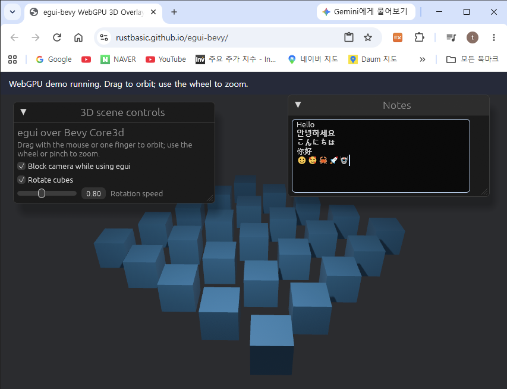

# egui-bevy

A small integration between egui and Bevy.

## Live Demo

[Open the WebGPU demo](https://rustbasic.github.io/egui-bevy/)



## Dependencies

- [egui](https://github.com/emilk/egui) ^0.37.0
- [Bevy](https://github.com/bevyengine/bevy) ^0.20.0

These are the versions currently used by this library.

## Motivation

I started this library because CJK text input worked for me in egui directly, but I couldn't get it working with `bevy_egui`. This project explores a separate integration path for using egui with Bevy.

I haven't yet evaluated the relative advantages and disadvantages of `bevy_egui` and `egui_bevy`, so this project does not claim that one is better than the other.

## Current status

The library provides `EguiBevyPlugin` for displaying egui over Core2d or Core3d output in each Bevy window. Add it after Bevy's renderer plugins and provide a callback that builds each egui frame:

```rust,ignore
app.add_plugins(EguiBevyPlugin::new(|ctx| {
    egui::Window::new("Hello").show(ctx, |ui| ui.label("Hello from egui"));
}));
```

By default, each Bevy window gets an independent egui context and UI frame. The callback runs on Bevy's main thread. The plugin forwards window-specific pointer, keyboard, DPI, and IME input, as well as clipboard copy, cut, and paste, then composites egui over the window's Core2d or Core3d view. Shared egui state across windows is also available through the explicitly mapped deferred-viewport mode described below. Each Bevy window supports one egui overlay; multiple camera views in one window are not supported. On WebAssembly, browser DOM text input is connected to the primary window only. The integration has been tested on Windows and WebAssembly; other platforms have not yet been tested.

### Shared egui viewports

To share one egui context between the primary window and existing secondary Bevy windows, enable `with_shared_viewports()` and map each secondary window with an `EguiViewport` component. Use the same unique `ViewportId` in the component and in `show_viewport_deferred`:

```rust,ignore
let inspector = egui::ViewportId::from_hash_of("inspector");

app.add_plugins(
    EguiBevyPlugin::new(move |ctx| {
        ctx.show_viewport_deferred(
            inspector,
            egui::ViewportBuilder::default().with_title("Inspector"),
            |ui, _class| {
                egui::CentralPanel::default().show(ui, |ui| {
                    ui.label("Inspector contents");
                });
            },
        );
    })
    .with_shared_viewports(),
);

// Spawn this as an existing secondary Bevy window:
commands.spawn((Window::default(), EguiViewport(inspector)));
```

The application must create and manage the Bevy windows itself; egui viewport requests do not automatically create or close Bevy windows. The primary window is the root viewport, and only secondary windows marked with `EguiViewport` are mapped to deferred child viewports.

`examples/windows-overlay` demonstrates a 2D scene with egui. `examples/multi-window` demonstrates per-window egui contexts, while `examples/multi-viewport` demonstrates one shared context across explicitly mapped deferred viewports. `examples/windows-3d-overlay` demonstrates a rotating 3D cube with interactive egui controls on Windows.
`examples/wasm-3d-overlay` is the WebGPU-only browser version. It is intended for GitHub Pages and requires a browser with WebGPU support; it does not include a WebGL2 fallback.

## Development

This project is developed with the assistance of AI.
