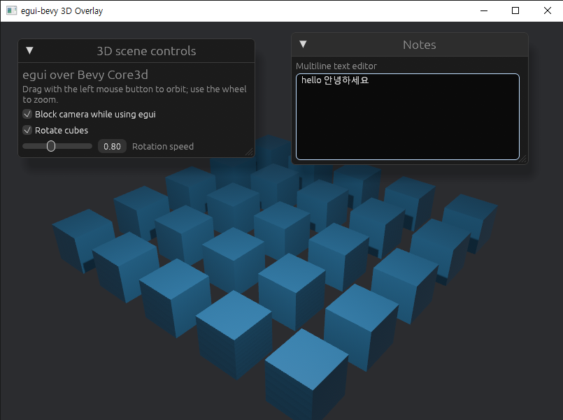

# egui-bevy

A small integration between egui and Bevy.

## Live Demo

[Open the WebGPU demo](https://rustbasic.github.io/egui-bevy/)

## Dependencies

- [egui](https://github.com/emilk/egui) ^0.37.0
- [Bevy](https://github.com/bevyengine/bevy) ^0.20.0

These are the versions currently used by this library.

## Motivation

I started this library because CJK text input worked for me in egui directly, but I couldn't get it working with `bevy_egui`. This project explores a separate integration path for using egui with Bevy.

I haven't yet evaluated the relative advantages and disadvantages of `bevy_egui` and `egui_bevy`, so this project does not claim that one is better than the other.

## Current status

The library provides an MVP `EguiBevyPlugin` for one primary window and one Core2d or Core3d view. Add it after Bevy's renderer plugins and provide a callback that builds each egui frame:

```rust,ignore
app.add_plugins(EguiBevyPlugin::new(|ctx| {
    egui::Window::new("Hello").show(ctx, |ui| ui.label("Hello from egui"));
}));
```

The callback runs on Bevy's main thread. The plugin forwards mouse, keyboard, DPI, and IME input, then composites egui over the Core2d or Core3d final output. Multiple windows/views are not yet supported. The integration has been tested on Windows and WebAssembly; other platforms have not yet been tested.

`examples/windows-overlay` demonstrates a 2D scene with egui. `examples/windows-3d-overlay` demonstrates a rotating 3D cube with interactive egui controls on Windows.
`examples/wasm-3d-overlay` is the WebGPU-only browser version. It is intended for GitHub Pages and requires a browser with WebGPU support; it does not include a WebGL2 fallback.



## Development

This project is developed with the assistance of AI.